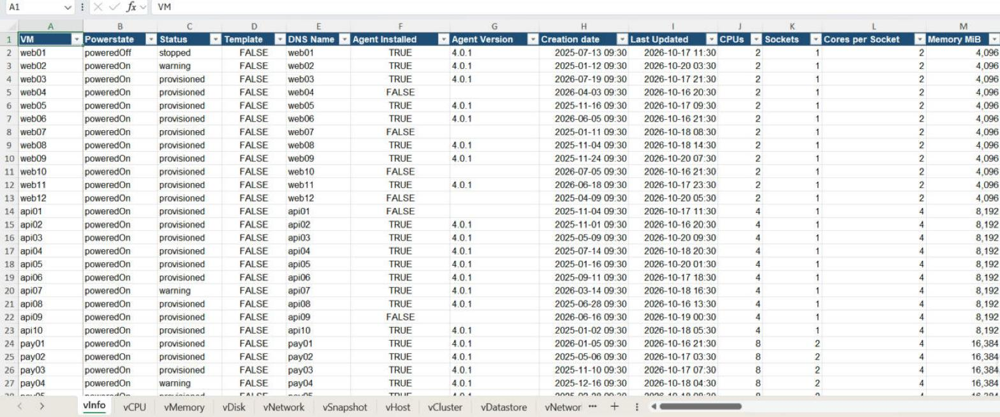
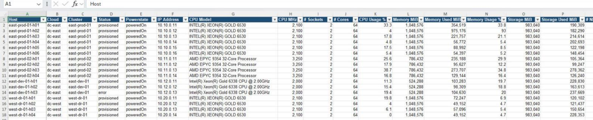
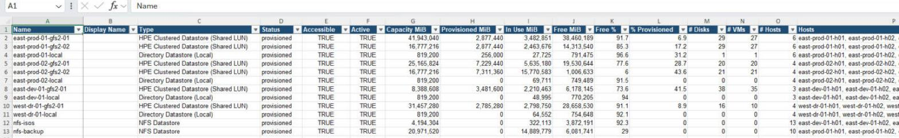
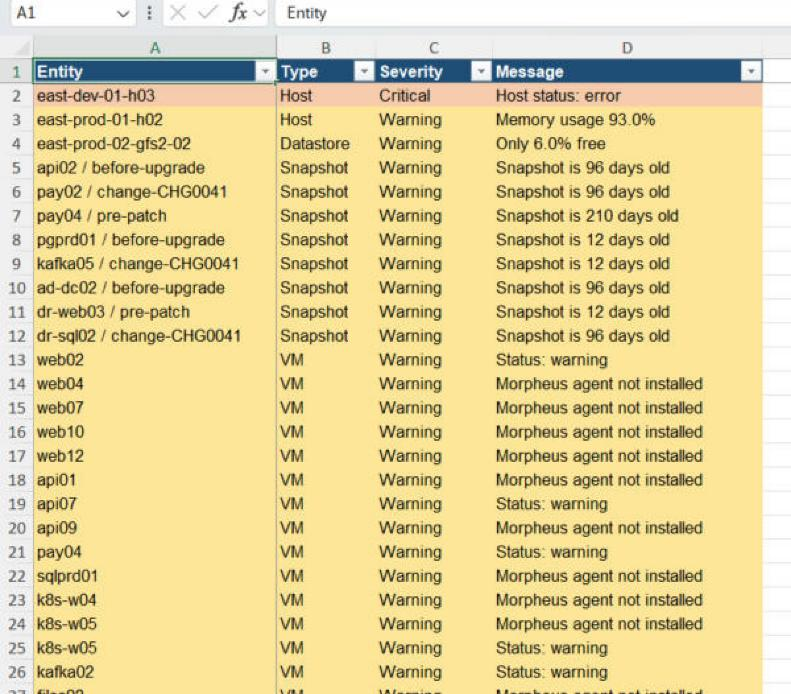
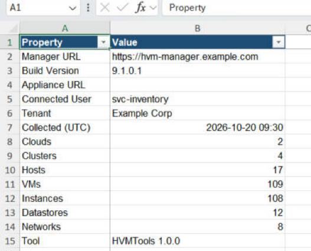

# HVMTools Plugin

[](LICENSE)


**Cluster-level inventory preview and RVTools-style Excel reports, directly in HPE Morpheus VM Essentials (VME / HVM).**

This fork adds an **HVMTools** tab to the cluster details page. Collect inventory
for the selected cluster, preview its worksheets in the browser, and download an
Excel workbook with hosts, VMs, storage, networks, snapshots and health findings.
The plugin is native Groovy/JVM code: **Python is not required on the appliance**.

The original **Python command-line exporter is retained**, including its
manager-wide inventory collection and offline workbook generation. Choose the
plugin for cluster-level reporting in the UI, or the CLI for scripts, jump boxes
and full-environment exports.

Use either for VMware-to-VME migration assessments, capacity planning, audits,
health checks and as-built documentation.

**Attribution:** this project is forked from
[grahamfairbank/hvmtools](https://github.com/grahamfairbank/hvmtools), created by
**Graham Fairbank**. The original exporter, inventory mappings, workbook design,
sample data and documentation provide the foundation for this plugin.
See [Attribution and license](#attribution-and-license).

**Status:** first plugin version, targeting **HPE VM Essentials 9.1.0.1**.
Initial use has been reported working; automated tests also compare its output
with the original Python exporter using fictional data. This is a community
project, not a vendor-certified plugin or a claim of compatibility with every
Morpheus/VME version.



<sub>Screenshots use the bundled fictional sample environment: 2 clouds, 4 clusters, 17 hosts, 109 VMs.</sub>

---

## Contents

- [Plugin overview](#plugin-overview)
- [Install the plugin](#install-the-plugin)
- [Use the cluster tab](#use-the-cluster-tab)
- [Plugin scope and limitations](#plugin-scope-and-limitations)
- [Python CLI](#python-cli)
  - [Features](#features)
  - [Requirements](#requirements)
  - [Installation](#installation)
  - [Quick start](#quick-start)
  - [Usage](#usage)
- [What's in the workbook](#whats-in-the-workbook)
- [Documentation](#documentation)
- [Security](#security)
- [Known limitations](#known-limitations)
- [Contributing](#contributing)
- [Attribution and license](#attribution-and-license)

---

## Plugin overview

- **A tab on each cluster:** generate a report without leaving the Morpheus UI.
- **Inventory preview:** select any of the 13 worksheets and browse 100 rows at a
  time before downloading the complete workbook.
- **Excel output:** familiar tabs, filters, frozen headers, UTC dates, MiB units
  and severity-coloured health findings, following the original exporter.
- **Collection options:** include snapshots, fetch missing usage statistics,
  adjust the snapshot-age warning threshold and add redacted raw sheets.
- **Current-user access:** inventory reads use your signed-in browser session
  and its API permissions, not a stored administrator token.
- **Read-only inventory:** no infrastructure resources are changed. Plugin POST
  requests only render the preview or workbook.

| | Cluster plugin | Python CLI |
|---|---|---|
| Entry point | HVMTools tab on a cluster | `python hvmtools.py` |
| Report scope | Selected cluster and related inventory | Entire inventory visible to the API account |
| Authentication | Signed-in browser session | Username/password or API token |
| Runtime | Native JVM plugin in the appliance | Python with `requests` and `openpyxl` |
| Offline JSON rebuild | Not exposed in the tab | `--dump-json` / `--from-json` |

## Install the plugin

### 1. Build the plugin JAR

On your development machine, install **JDK 17** and set `JAVA_HOME` to its
installation directory. A global Gradle installation is not needed: the included
wrapper downloads the pinned version. The first build needs internet access to
download Gradle and Maven dependencies.

```bash
git clone https://github.com/TheBoringGamer/hvmtools-plugin.git
cd hvmtools-plugin/plugin

# Linux example; adjust this path for your JDK installation.
export JAVA_HOME=/usr/lib/jvm/java-17-openjdk-amd64
export PATH="$JAVA_HOME/bin:$PATH"

./gradlew shadowJar --no-daemon
```

On Windows, set `JAVA_HOME` to JDK 17 and use `gradlew.bat`.

The installable file is:

```text
plugin/build/libs/hvmtools-plugin-0.1.0-all.jar
```

Use the **`-all.jar`**, which bundles the workbook dependencies, not a thin JAR.
Neither Python nor Node.js is required just to build the installable JAR. For
development tests and workbook parity checks, see the
[plugin build guide](plugin/README.md#build-environment).

### 2. Upload it to Morpheus

1. Sign in to your VME appliance with an account allowed to manage plugins.
2. Open **Administration → Integrations → Plugins**. Navigation labels can vary
   by appliance version.
3. Upload `hvmtools-plugin-0.1.0-all.jar` and confirm that **HVMTools** loads.
   If it fails, check the appliance plugin logs for SDK or class-loading errors.
4. Grant the reporting role **HVMTools cluster inventory: Read**. This plugin
   permission defaults to no access.
5. Ensure the role also has read access to the relevant clusters, servers,
   instances, clouds, groups, networks and datastores, plus snapshots if enabled.

No separate Python environment, API token or service-account credentials need to
be configured on the appliance.

## Use the cluster tab

1. Open a cluster under **Infrastructure** and select its **HVMTools** tab.
2. Choose your report options:
   - **Include snapshots:** collect snapshots for related instances.
   - **Fetch missing usage statistics:** query server details when list responses
     omit usage metrics.
   - **Include redacted raw sheets:** add `raw_servers`, `raw_instances` and
     `raw_datastores` to the downloaded workbook.
   - **Snapshot warning age:** flag snapshots older than this many days;
     the default is **7**.
3. Click **Collect and preview** and wait for collection to finish.
4. Select a worksheet from the dropdown. Use **Previous** and **Next** to page
   through its rows.
5. Click **Download Excel**. The workbook includes all rows, not just the current
   preview page.
6. Open the workbook and start with **vSource** for collection details and
   **vHealth** for findings.

The download uses the inventory you just collected. Collect again to refresh the
data, or after changing snapshot, statistics or warning-age options.

If the tab is missing, check the plugin and role permission. If collection fails,
check the displayed error, your session and API read permissions. The plugin
stops on failed or denied inventory reads rather than producing a misleading
empty workbook.

## Plugin scope and limitations

- Hosts, VMs and their related resources are scoped to the **selected cluster**.
  Unused datastores attached to the cluster are included too.
- **Shared datastore capacity/free space is global.** VM/disk counts and
  provisioned storage totals reflect the selected cluster.
- **Instances and snapshots can span clusters.** Snapshots are an instance-level
  resource; instance metadata and raw membership references may include VMs
  outside the selected cluster.
- `vSource` counts describe the scoped report. Manager-version and current-user
  fields are blank in plugin exports because the collector does not query them.
- Some API lists are read across the user's visible inventory and then filtered.
  Large environments can take longer to collect.
- Preview/export run in memory. Inventory input is limited to **25 MiB**;
  appliance/proxy request-size and timeout limits may be lower.
- Use a trusted HTTPS browser session. The plugin relies on Morpheus session
  authentication and CSRF protection; it has no TLS-bypass option.
- Workbooks contain infrastructure details even after credential redaction.
  Keep exports private and do not commit real inventory or reports.

See the [plugin guide](plugin/README.md) for implementation details, compatibility
considerations and the full deployment-validation checklist.

---

## Python CLI

The original single-file exporter, `hvmtools.py`, remains available and unchanged.
It connects to an HPE VM Essentials manager through the Morpheus REST API,
collects the full inventory visible to its account, and writes a single
RVTools-style Excel workbook. Each object type gets its own tab and each object
its own row, ready for sorting, filtering and sharing.

The following requirements, commands and flags apply to the **Python CLI**, not
the cluster tab.

## Features

- **One command, one workbook.** Logs in, gathers everything, writes an `.xlsx`.
- **RVTools-familiar tabs:** `vInfo`, `vCPU`, `vMemory`, `vDisk`, `vNetwork`, `vSnapshot`, `vHost`, `vCluster`, `vDatastore`, `vNetworks`, `vHealth`, `vSource`, plus a Morpheus-specific `vInstance` tab.
- **Cluster storage awareness:** `vDatastore` includes the datastores on each cluster's *Storage → Data Stores* tab (GFS2 shared LUNs, NFS, local directories) alongside cloud-level datastores. Each row has capacity, free %, provisioned/overcommit %, VM and disk counts, and the hosts that see the datastore.
- **Host hardware:** CPU model and speed, sockets, cores, vendor and model for every HVM host, with vCPU:core ratio and allocated vRAM.
- **Built-in health checks (`vHealth`):** hosts in a bad state or in maintenance mode, host memory above 90%, datastores under 10% free, VMs in a bad state or powered off, running VMs without the Morpheus agent, and snapshots older than a configurable number of days.
- **Raw mode:** `--raw` adds sheets containing every field the API returned, so nothing is lost even if a field isn't mapped to a friendly column. Credential fields are redacted.
- **Offline rebuilds:** `--dump-json` saves the collected data, and `--from-json` rebuilds the workbook later without touching the manager. Collect on a jump box, report anywhere.
- **Read-only.** HVMTools only issues `GET` requests (plus the login call). It never changes anything in your environment.
- **Single file, two dependencies:** `requests` and `openpyxl`.

---

## Requirements

- Python 3.8 or newer, on Windows, macOS or Linux
- HTTPS (443) access from the machine running the tool to the VME manager
- A VME user account (or API token) with read access to Infrastructure (clouds, clusters, hosts, VMs), Provisioning (instances), Networks and Storage. A read-only role is enough.

Verified against HPE VM Essentials **9.1.0.1**. See [Compatibility](docs/HOW-IT-WORKS.md#compatibility).

---

## Installation

```bash
git clone https://github.com/TheBoringGamer/hvmtools-plugin.git
cd hvmtools-plugin
python3 -m venv .venv
source .venv/bin/activate        # Windows: .venv\Scripts\activate
pip install -r requirements.txt
```

---

## Quick start

**1. Try it without a manager**, using the bundled sample data:

```bash
python hvmtools.py --from-json examples/sample-inventory.json -o sample.xlsx
```

**2. Run it against your manager.** You will be prompted for the password, which isn't echoed:

```bash
python hvmtools.py --url https://hvm-manager.example.com -u svc-inventory --insecure
```

`--insecure` is needed when the manager still has its default self-signed certificate. Leave it off if the certificate is trusted.

```
[09:30:02] Connecting / ping
[09:30:04] Servers (hosts + VMs)
[09:30:06]   126 servers
[09:30:06] Instances
[09:30:07]   108 instances
[09:30:08] Datastores (cluster Storage tabs + clouds)
[09:30:09]   12 datastores
[09:30:09] Snapshots (108 instances)
[09:30:12] Wrote HVMTools_hvm-manager.example.com_20261020_0930.xlsx: vInfo=109, vCPU=109, vMemory=109, vDisk=181, ...
```

**3. Open the workbook** and start with **vSource** (what was collected, from where and when) and **vHealth** (anything that needs attention). [Using the workbook](docs/USING-THE-WORKBOOK.md) walks through migration, capacity and health-check recipes.

Using an API access token (*User Settings → API Access* in the VME UI) instead of a password:

```bash
python hvmtools.py --url https://hvm-manager.example.com --token <ACCESS_TOKEN>
```

---

## Usage

```
python hvmtools.py [options]
```

| Option | Description |
|---|---|
| `--url URL` | Manager URL, e.g. `https://hvm-manager.example.com`. `https://` is added if omitted. |
| `-u`, `--username` | Username to log in with. Prompted if not supplied. |
| `-p`, `--password` | Password. Prompted securely if omitted (recommended, so it stays out of shell history). |
| `--token TOKEN` | Use an existing API access token instead of username/password. |
| `--insecure` | Skip TLS certificate verification (for self-signed certificates). |
| `-o`, `--output FILE` | Output workbook path. Default: `HVMTools_<host>_<YYYYMMDD_HHMM>.xlsx`. |
| `--no-snapshots` | Skip per-instance snapshot queries. Speeds up large environments; `vSnapshot` will be empty. |
| `--no-stats` | Skip the per-server usage stats queries made when the server list omits stats. Memory, CPU and disk usage columns may then be blank. |
| `--raw` | Add `raw_servers`, `raw_instances` and `raw_datastores` sheets containing every API field (credentials redacted). |
| `--dump-json FILE` | Save the collected inventory to a JSON file as well (credentials redacted). |
| `--from-json FILE` | Build the workbook from a previously dumped JSON file. No API calls are made. |
| `--snapshot-age N` | `vHealth` flags snapshots older than N days. Default: 7. |
| `--page-size N` | Items requested per API page. Default: 100. |
| `--workers N` | Parallel threads for per-instance snapshot and per-server stats queries. Default: 8. |
| `--version` | Print the HVMTools version and exit. |

### Environment variables

Any of these can be set instead of passing the matching option:

| Variable | Equivalent option |
|---|---|
| `MORPHEUS_URL` | `--url` |
| `MORPHEUS_USER` | `--username` |
| `MORPHEUS_PASS` | `--password` |
| `MORPHEUS_TOKEN` | `--token` |

```bash
export MORPHEUS_URL=https://hvm-manager.example.com
export MORPHEUS_USER=svc-inventory
python hvmtools.py --insecure
```

### Common recipes

Collect on one machine, report on another:

```bash
# On the jump box (has access to the manager)
python hvmtools.py --url https://hvm-mgr -u svc-inventory --dump-json inventory.json

# Anywhere else
python hvmtools.py --from-json inventory.json -o customer-report.xlsx
```

Capture everything for troubleshooting or field mapping:

```bash
python hvmtools.py --url https://hvm-mgr -u svc-inventory --raw --dump-json inventory.json
```

Fast run on a large environment:

```bash
python hvmtools.py --url https://hvm-mgr -u svc-inventory --no-snapshots
```

Flag only snapshots older than a month:

```bash
python hvmtools.py --url https://hvm-mgr -u svc-inventory --snapshot-age 30
```

---

## What's in the workbook

| Tab | One row per | Summary |
|---|---|---|
| `vInfo` | VM | Main VM inventory: power state, CPU, memory, disks, IPs, networks, host, cluster, group, plan, OS, tags, IDs |
| `vCPU` | VM | vCPU count, sockets, cores per socket, CPU usage % |
| `vMemory` | VM | Configured memory, consumed, free, usage % |
| `vDisk` | VM disk | Capacity, used, boot disk, device, controller, datastore, storage type |
| `vNetwork` | VM NIC | Network, VLAN, IPv4/IPv6, MAC, adapter type, primary flag |
| `vSnapshot` | Snapshot | Instance, name, created date, age in days, type, state |
| `vHost` | Hypervisor host | CPU model, sockets, cores, memory, usage, VM count, vCPU:core ratio, vRAM, OS, vendor/model, maintenance mode |
| `vCluster` | Cluster | Hosts, VMs, total cores and memory, allocated vCPU and vRAM |
| `vDatastore` | Datastore | Type (GFS2 shared LUN, NFS, local), capacity, free, provisioned %, NFS server/export or LUN device, hosts, cluster |
| `vNetworks` | Network | CIDR, gateway, DNS, VLAN, DHCP, IP pool, NIC count |
| `vInstance` | Morpheus instance | Instance type, layout, plan, group, environment, owner, member VMs |
| `vHealth` | Finding | Health check results, colour-coded by severity |
| `vSource` | Property | Manager URL, build version, connected user, collection time, object counts |

Sizes are in **MiB** to match RVTools. Dates are UTC.

**vHost**: hardware, capacity and VM density per host



**vDatastore**: GFS2, NFS and local datastores with free and provisioned %



<table>
<tr>
<td width="50%" valign="top"><a href="docs/images/vhealth.jpg"></a><br><b>vHealth</b>: findings sorted and shaded by severity</td>
<td width="50%" valign="top"><a href="docs/images/vsource.jpg"></a><br><b>vSource</b>: where, when and by whom the data was collected</td>
</tr>
</table>

See **[docs/SHEETS.md](docs/SHEETS.md)** for every column and where its data comes from.

---

## Documentation

| Document | Contents |
|---|---|
| [plugin/README.md](plugin/README.md) | Native plugin build environment, installation, scope, limitations and validation |
| [docs/USING-THE-WORKBOOK.md](docs/USING-THE-WORKBOOK.md) | Recipes: health check, migration assessment, right-sizing, capacity review, snapshot hygiene |
| [docs/SHEETS.md](docs/SHEETS.md) | Column-by-column reference for every tab, with the API field each value comes from |
| [docs/HOW-IT-WORKS.md](docs/HOW-IT-WORKS.md) | Authentication, API endpoints, compatibility, how hosts/VMs/clusters/datastores are matched, redaction, error handling |
| [docs/TROUBLESHOOTING.md](docs/TROUBLESHOOTING.md) | Login failures, certificate errors, blank columns, permissions, performance |
| [docs/RVTOOLS-MAPPING.md](docs/RVTOOLS-MAPPING.md) | How HVMTools tabs and columns relate to RVTools, for VMware admins |
| [CHANGELOG.md](CHANGELOG.md) | Version history |

---

## Security

For the plugin, inventory reads use your existing browser session, report POSTs
use Morpheus CSRF protection, and credential-like fields are redacted before
submission and again on the server. No separate login credentials are stored.
The authentication flags and environment-variable guidance below apply to the CLI.

- Credentials are used only to obtain an OAuth access token from the manager. They are never written to disk or to the workbook.
- Credential-like fields the API returns (each server's agent `apiKey`, `sshPassword`, `sshPasswordHash`, cluster service passwords and tokens) are replaced with `<redacted>` in `--raw` sheets and `--dump-json` files.
- Prefer the password prompt or `MORPHEUS_TOKEN` over `-p` on the command line, so secrets don't end up in shell history.
- Use a dedicated **read-only** account for reporting.
- `--insecure` disables certificate checking. Use it only on networks you trust, or install the manager's CA certificate instead (see [Troubleshooting](docs/TROUBLESHOOTING.md#tls-error--certificate_verify_failed)).
- The workbook and any `--dump-json` file contain infrastructure details (hostnames, IPs, MACs, network layout). Treat them as sensitive and don't commit them to a repository. The included `.gitignore` excludes `*.xlsx` and `inventory*.json`.

---

## Known limitations

- Field names in the Morpheus API can vary between VME versions. Columns your version doesn't return are left blank rather than failing; run with `--raw` to see exactly what your manager returns.
- Usage figures (consumed memory, CPU usage %, used disk) are a single point-in-time sample reported by the manager.
- The 9.1 API doesn't expose host serial numbers, guest partitions, or physical NIC/HBA detail, so there are no columns for them.
- Snapshot collection makes one API call per instance; use `--no-snapshots` if this is slow.
- If the server list omits usage stats, one extra API call is made per affected server; use `--no-stats` to skip it.

---

## Contributing

Issues and pull requests are welcome. When reporting a blank or incorrect column, please include:

1. Whether you used the plugin or the Python CLI, and your VME version. For CLI
   exports, this is shown on `vSource` as *Build Version*; for the plugin, check
   the appliance version directly.
2. The relevant row from a `raw_*` sheet, with hostnames, IPs and other sensitive
   values removed. Enable **Include redacted raw sheets** in the plugin or use
   `--raw` with the CLI.

If you add a column, update [docs/SHEETS.md](docs/SHEETS.md) and [CHANGELOG.md](CHANGELOG.md), and add the field to `examples/generate_sample.py` so the sample exercises it.

---

## Attribution and license

The original **HVMTools** project was created by **Graham Fairbank**:

- Original repository: [grahamfairbank/hvmtools](https://github.com/grahamfairbank/hvmtools).
- This fork: [TheBoringGamer/hvmtools-plugin](https://github.com/TheBoringGamer/hvmtools-plugin).
- Original copyright: **Copyright (c) 2026 Graham Fairbank**.

This fork adds the native Morpheus cluster-tab integration, browser preview,
cluster-scoped collection and JVM workbook generation. It retains the original
Python exporter and documentation, and builds on the original author's inventory
mappings, report structure and sample environment. The plugin is a derivative
community implementation, not a claim that the original author maintains or
endorses this fork.

HVMTools is released under the [MIT License](LICENSE). You are free to use, modify and distribute it, including for commercial work, provided the copyright notice is kept. The software is provided "as is", without warranty of any kind.

---

## Disclaimer

HVMTools is an independent community project. It is not affiliated with, endorsed by, or supported by Hewlett Packard Enterprise, Morpheus Data, Broadcom/VMware, or Dell Technologies (the publisher of RVTools). HPE, Morpheus, VMware, Dell and RVTools are trademarks of their respective owners.
